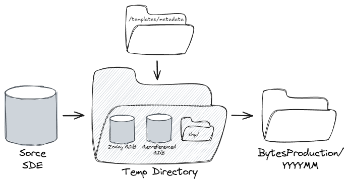

# Zoning Process

## Overview
The `processes/zoning` module prepares and distributes TRD-owned zoning products, as defined in `constants.py`. It extracts zoning features from the source database, applies transformations such as field filtering and spatial operations, generates and applies standardized updated metadata, and packages the results for distribution to the desired open data staging directory. 

## Prerequisites
- The GIS Team conda environment (`gis-env`), which includes `arcpy`. See [Development Environment Setup](../../docs/wiki.md#development-environment-setup).
- SDE connection files for the source database, in the folder set by `connection_file_path` in the global config
- `[env]_config.yml` files for both the global config (`config/`) and the product config (`processes/zoning/config/`), created from their `template_config.yml`
- Zoning data dictionaries (`.xlsx`, listed in `ZONING_DATA_DICTS` in `constants.py`) in `<open_data_staging_path>/zoning/_metadata_staging/`

## How to run
To run, establish `gis-nycplanning/` as your base directory and run `python processes/zoning/zoning.py --env prod` or `python processes/zoning/zoning.py --env dev` in your terminal.

## Key Components
 `config/`
- `[env]_config.yml` — global config
- `template_config.yml` — global config template with variable descriptions
 

 `processes/zoning/`
 - `zoning.py` — main orchestration script
 - `constants.py` — configuration dictionaries and naming conventions
- `utils.py` — helper functions for export, metadata, and cleanup. These utilities are specific to Zoning distribution, but may be conceptually applicable to other products.
 - `config/` — product-specific configuration files
- `documentation/` — workflow diagram (`.excalidraw` source and `.png`)

 `src/dcpgis/`
- `cli.py` — command-line argument parsing (`--env`)
 - `utils/` — global utilities

## Configuration
Environment arguments: `--env dev`, `--env prod`

Config Files
- `config/[env]_config.yml`: 
  - [env] determined by --env CLI argument
  - Variable descriptions can be found in `/config/template_config.yml`
  - The global config is intended to only include variables that are broadly applicable. Editable values only need to be filled in to override the default; otherwise they are calculated at runtime:
    - `open_data_cycle_date` (YYYYMM): auto-calculated from the current date
    - `city_council_date` (YYYYMMDD): defaults to the latest `EFFECTIVE` date in `DZM_nyzi` (zoning map amendments)
- `processes/zoning/config/[env]_config.yml`: 
  - [env] determined by --env CLI argument
  - Variable descriptions can be found in `/processes/zoning/config/template_config.yml`
  - The intention of having a local product config is to allow for product-by-product variability

 ## Workflow
 - Temporary staging directory creation
 - Creating geodatabases and shapefile outputs
 - Exporting zoning feature classes
- Dropping internal-only fields (`desired_fields`) and dissolving Special Districts on `SDNAME`
 - Copying and packaging raster/map products
 - Metadata generation and application
- Copying data dictionaries from `_metadata_staging/` into `web/` and `metadata/`
 - Final staging to open data directories
 - Temp directory deleted

Outputs are written to `<open_data_staging_path>/zoning/<YYYY>/<YYYYMM>/`, which contains `gdb/`, `shp/`, `metadata/` and `web/`. `web/` holds the current zips and data dictionaries; cycle-dated copies of the zips (e.g. `nyc_zoning_features_<YYYYMM>_gdb.zip`) are written to `web/archive/`. Re-running for the same cycle overwrites the existing files.

- `prod_zoning.log` and/or `dev_zoning.log` are written to `processes/zoning/log/`. Logging defaults to `INFO` and can be overridden in the global config (e.g., `log_level_override: DEBUG`). `DEBUG` also logs the resolved paths.
- Failures are logged with a full traceback under "Process failed".
 
 ## Troubleshooting
- **File lock errors during zipping or the final copy:** close ArcGIS Pro and any Catalog windows that have the output open, then re-run. As a last resort, set `dangerous_ignore_locks=True` in the `archive_zipping()` call in `zoning.py`.
- **Missing data dictionaries:** check that every file in `ZONING_DATA_DICTS` is in `_metadata_staging/`.

## Contributing / Extending
- Metadata
  - Updates to static descriptive language can be made directly to the XMLs in `processes/zoning/templates/metadata/`.
  - Metadata XMLs contain in-text `{variables}` defined in `METADATA_XML_VALUES` in `constants.py`. Values left as `""` are filled in at runtime from the product convention dictionaries (`ZONING_CONVENTIONS`, `GEOREF_CONVENTIONS`) and the cycle and council dates.

- Updating naming conventions or incorporating a new output?
  - File naming conventions can be updated in `constants.py`. Source, output, and schema information can be updated in the respective `{}_CONVENTIONS` dictionary; packaging outputs such as zipfile names, contents, and destination folders (`output_dir`, e.g. `web` or `web/archive`) can be updated in `ZONING_PACKAGING`. 
  - Note: If a product's `public_output_name` is changed, rename the corresponding XML template to match
  - New zoning features can be added to outputs by updating `constants.py`. For example, if the Zoning Index were to be added as a desired output.
 